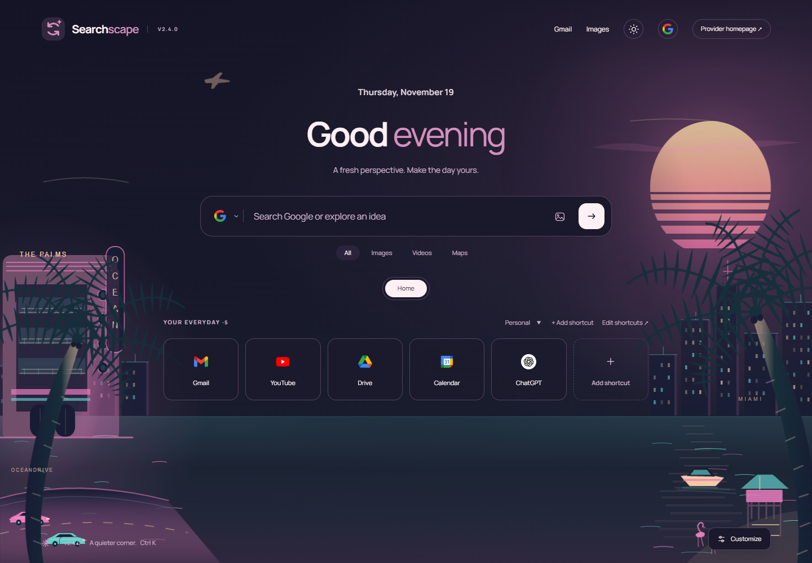

# Searchscape v2.4.0

## GTA VI · Miami

A new Miami-inspired coastal scene with a striped sunset, pink and cyan neon, an Art Deco hotel, bayfront towers, detailed palms, ocean reflections and a beach cabana.

Palms sway in the breeze, traffic passes along Ocean Drive, a boat crosses the marina, and window lights and reflections move independently. A slow distant flight and shoreline flamingos add smaller details.

Find it under **Customize → Coastal Escapes → GTA VI · Miami**, or search themes for **Miami** or **GTA VI**.

Both light and dark palettes are included. Motion follows the animation toggle, Subtle intensity, reduced-motion preference and hidden-tab pause. Original artwork and animation load locally.

To update from v2.3.2 or later, replace the files in the existing unpacked extension folder, reload Searchscape at brave://extensions, and open a fresh tab.

If upgrading from v2.3.1 or earlier, export your settings before installing. See SYNC_UPGRADE.md in the ZIP or the repository's browser-sync guide.
